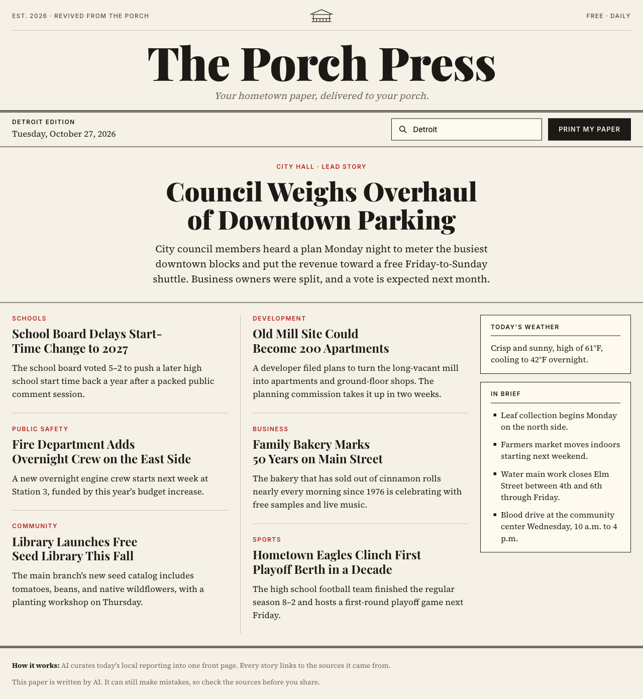
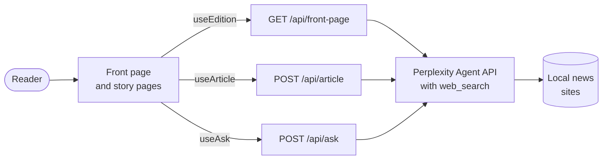

<div align="center">


# The Porch Press

**Your town's daily paper, delivered to your porch.**

Pick a neighborhood or town and get today's local news laid out as a newspaper front page.<br />
Every story links to its sources, every article is one click away, and you can ask follow-up questions.

[**Read today's edition at porchpress.app →**](https://porchpress.app)

[](https://nextjs.org)
[](https://react.dev)
[](https://www.typescriptlang.org)
[](https://docs.perplexity.ai)
[](LICENSE)
[](https://github.com/sponsors/ryanburr)

<br />

<a href="https://porchpress.app"></a>

</div>

<br />

## What's in the paper

- **A front page for your place.** Choose Detroit, one of its neighborhoods, or a nearby town. Perplexity searches the past week of local reporting and an AI editor picks a lead story, the stories below it, the weather, and a column of briefs.
- **Full articles.** Open any story for a longer write-up with numbered citations that link back to the original reporting.
- **Ask a follow-up.** "When is the next vote?" "How can residents weigh in?" Answers stream in live and cite their sources too.
- **In your language.** Read the paper in English, Spanish, Arabic, French, or Hindi. It opens in your browser's language, and the masthead lets you switch.
- **Print my paper.** A print stylesheet turns any page into black-and-white letter paper you could leave on the porch.
- **Works without a key.** With no API key set, every route serves a sample edition, so you can build the UI offline.

## How it works



The app is a single Next.js project. Three API routes call Perplexity's Agent API with its `web_search` tool, ask for structured JSON or streamed text, and hand the results to client hooks. Front pages are cached per town, day, and language on the server and in the reader's `localStorage`, which keeps it fast and the API bill small.

## Run it locally

You'll need [Node.js](https://nodejs.org) 20.9 or newer and [pnpm](https://pnpm.io) 10 (`corepack enable` sets it up).

```bash
git clone https://github.com/ryanburr/porch-press.git
cd porch-press
pnpm install
cp .env.example .env.local   # optional: add your PERPLEXITY_API_KEY
pnpm dev
```

Open [localhost:3000](http://localhost:3000). Without a key you'll see the sample edition. Get a key from the [Perplexity API settings](https://www.perplexity.ai/settings/api) to print real news.

| Command | What it does |
| --- | --- |
| `pnpm dev` | Start the dev server with hot reload |
| `pnpm build` | Build for production (also type-checks) |
| `pnpm start` | Serve the production build |
| `pnpm lint` | Run ESLint |

## Project layout

```text
src/
├── proxy.ts                   sends / to the reader's language
├── app/
│   ├── [lang]/
│   │   ├── page.tsx           front page
│   │   └── story/[town]/[id]/ article page with the follow-up chat
│   └── api/
│       ├── front-page/        today's edition for a town
│       ├── article/           full article for one story
│       └── ask/               streamed answers to follow-up questions
├── components/                masthead, dateline, place picker, stories, sidebar, ask
├── lib/
│   ├── perplexity.ts          Agent API client
│   ├── types.ts               Edition, Story, Article, Source
│   ├── places.ts              the towns and neighborhoods in the picker
│   ├── i18n.ts                the languages and their text direction
│   ├── dictionaries/          page text per language
│   ├── sample.ts, samples/    the offline sample edition per language
│   └── use-*.ts               client hooks for the API routes
└── styles/
    ├── tokens.css             colors, type, spacing
    ├── components.css         newsprint components
    └── print.css              black-and-white print edition
```

<details>
<summary><b>API reference</b></summary>

<br />

Types live in `src/lib/types.ts`. `stories[0]` of an `Edition` is the lead story. All calls go through Perplexity's Agent API (`/v1/agent`) with its `web_search` tool; `src/lib/perplexity.ts` wraps it.

| Route | Call | Returns |
| --- | --- | --- |
| `GET /api/front-page?town=Asheville, NC&date=YYYY-MM-DD&lang=es` | effort `low`, JSON schema, last-week recency (~20s) | `Edition`. Cached per town, day, and language; add `&fresh=1` to reprint. |
| `POST /api/article` `{ town, story, lang }` | effort `fast` (~6s) | `Article`: plain-text `body` with `[n]` markers matching `source.id` |
| `POST /api/ask` `{ town, lang, story, article, messages }` | effort `fast`, streamed (~4s) | Answer text with `[n]` markers, then `\u001e` and a JSON array of sources |

Client hooks for components:

- `useEdition(town, lang)` → `{ edition, loading, error, reprint }` (cached in localStorage per day and language)
- `useArticle(edition, story, lang)` → `{ article, loading, error }`, plus `paragraphsOf(article)`
- `useAsk(town, story, article, lang)` → `{ turns, busy, ask(question) }`; each turn's `answer` streams in live

</details>

## Languages

Every page lives under its language: `/en`, `/es`, `/ar`, `/fr`, `/hi`. `src/proxy.ts` sends a path without one (`/`, `/story/...`) to the reader's saved choice from the masthead switcher, else their browser's `Accept-Language`, else English.

- `src/lib/i18n.ts`: the language list, text direction, and the `fill` and `plural` helpers.
- `src/lib/dictionaries/`: page text per language. `en.ts` sets the shape, so TypeScript flags any missing string.
- `src/lib/samples/`: the offline sample edition per language.
- Perplexity writes stories, articles, and answers in the page's language. Section names stay English in the data and are translated on the page.
- Arabic pages are right to left, so layout CSS uses logical properties (`padding-inline-start`, not `padding-left`). Arabic and Hindi load their own fonts; the masthead keeps Playfair.

To add a language, add it to `LOCALES` and `LANGUAGES`, then add a dictionary and a sample edition.

## Contributing

Bug reports, ideas, new places, and pull requests are all welcome. Start with [CONTRIBUTING.md](CONTRIBUTING.md) for setup, conventions, and what to check before you open a PR. If you're not sure where to begin, [open an issue](https://github.com/ryanburr/porch-press/issues/new) and say hello.

## Support the paper

The Porch Press is free to read. Every edition costs a little in API calls, though. If you'd like to help keep the presses running, [sponsor the project on GitHub](https://github.com/sponsors/ryanburr) or click the **Sponsor** button at the top of the repo.

## License

[MIT](LICENSE). Made by [@ryanburr](https://github.com/ryanburr) and [@briannaworkman](https://github.com/briannaworkman).
